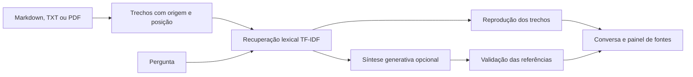

# AtendeDoc

**A resposta começa nos seus documentos — e mostra de onde veio.**

Converse em português com políticas, produtos e procedimentos. Cada consulta recupera trechos relacionados à pergunta e apresenta o documento, a seção e a posição da informação. A interface reúne uma conversa central e um painel de fontes, com consulta local e síntese generativa opcional.


[Estudo de caso](docs/ESTUDO_DE_CASO.md) · [Arquitetura](docs/ARQUITETURA.md) · [Avaliação](reports/evaluation.json)

## Experimente

Na raiz do projeto, instale as dependências e abra o aplicativo. No Windows:

```powershell
py -3.14 -m venv .venv
.\.venv\Scripts\python.exe -m pip install -r requirements.txt
.\.venv\Scripts\python.exe -m streamlit run app.py --server.port 8502 --server.showEmailPrompt false
```

Abra `http://127.0.0.1:8502`. A base demonstrativa acompanha o código e a consulta local funciona sem chave de API ou download de modelos.

O projeto foi testado em Python 3.12 e a interface também foi executada localmente com Python 3.14. Em Linux/macOS:

```bash
python3 -m venv .venv
.venv/bin/python -m pip install -r requirements.txt
.venv/bin/python -m streamlit run app.py --server.port 8502 --server.showEmailPrompt false
```

## Da pergunta à fonte

1. **Escolha a biblioteca:** use a loja demonstrativa ou envie seus documentos no painel à direita.
2. **Faça uma pergunta:** escolha uma pergunta rápida ou escreva no campo de mensagem.
3. **Leia a resposta:** a consulta local reproduz trechos com referências como `[F1]`, `[F2]` e `[F3]`.
4. **Confira as fontes:** selecione uma pergunta do histórico, abra os trechos originais e verifique a página ou as linhas de origem.
5. **Guarde a consulta:** baixe a pergunta, a resposta e suas fontes em JSON.

O histórico mantém até seis consultas em ordem cronológica. Cada pergunta consulta a base de forma independente; o histórico não é enviado como contexto de conversa ao modelo. **Nova conversa** limpa as consultas da sessão. Mudar a base ou o formato da resposta inicia um histórico novo.

## O que está implementado

| Recurso | Comportamento |
|---|---|
| Biblioteca própria | Recebe Markdown, TXT e PDF com texto selecionável |
| Recuperação de informação | TF-IDF de palavras e sequências de caracteres, com até três fontes |
| Consulta local | Reproduz os trechos encontrados, sem usar LLM |
| Síntese com IA | Redige uma resposta a partir dos trechos, com validação dos identificadores citados |
| Fontes rastreáveis | Documento, seção e posição por página ou linhas |
| Ausência de informação | Informa quando a consulta não encontra evidência suficiente |
| Histórico e exportação | Até seis consultas por sessão e download individual em JSON |
| API | Rotas HTTP para a base demonstrativa, com documentação interativa |

## Uma demonstração que você pode conferir

A base inicial descreve a **Lume Casa, uma loja fictícia**, com políticas e produtos criados para o projeto. São três documentos e vinte trechos indexados.

| Pergunta de exemplo | O que demonstra |
|---|---|
| Qual é o prazo de entrega para São Paulo? | Recuperação de uma política de entrega |
| Como posso devolver um produto? | Consulta a um procedimento |
| Existe desconto para Pix? | Localização de uma condição de pagamento |
| A Caneca Brisa pode ir ao micro-ondas? | Consulta a informações de produto |
| Qual é a previsão do tempo amanhã? | Pergunta sem informação correspondente na base |

Perguntas sobre pedidos individuais recebem orientação para atendimento autenticado. O projeto não consulta sistemas de pedidos, contas ou pagamentos.

## Usar seus documentos

Selecione **Meus documentos** e envie os arquivos. Essa biblioteca substitui a demonstração naquela sessão; as fontes exibidas pertencem à base selecionada.

| Limite | Valor |
|---|---:|
| Arquivos por base | Até 5 |
| Tamanho por arquivo | Até 2 MB |
| Páginas por PDF | Até 30 |
| Caracteres por arquivo | Até 150.000 |
| Caracteres por base | Até 300.000 |
| Trechos por base | Até 600 |

Markdown e TXT usam UTF-8. PDFs precisam ter texto selecionável; arquivos digitalizados precisam passar por OCR antes do envio. Os arquivos e o histórico ficam na memória da sessão da interface.

## Avaliação reproduzível

O [relatório de referência](reports/evaluation.json) usa 28 perguntas definidas para a loja demonstrativa:

| Grupo | Quantidade |
|---|---:|
| Consultas com documento e seção esperados | 20 |
| Perguntas fora da base | 5 |
| Casos de encaminhamento ou proteção de dados | 3 |

| Critério | Resultado no conjunto do projeto |
|---|---:|
| Perguntas com critérios atendidos | **28 / 28** |
| Recuperação da seção esperada entre as três primeiras fontes | **20 / 20** |

Os resultados descrevem um conjunto pequeno e específico da base fictícia. A recuperação da seção esperada não equivale a medir a qualidade de redação de um LLM, nem garante o mesmo resultado em documentos externos.

Para reproduzir a avaliação ou consultar pelo terminal:

```powershell
.\.venv\Scripts\python.exe -m atendedoc evaluate
.\.venv\Scripts\python.exe -m atendedoc ask "Como posso devolver um produto?"
```

## Síntese com IA opcional

O modo **Trechos dos documentos** funciona localmente. Para habilitar **Síntese com IA**, configure no ambiente do servidor uma chave e um modelo da sua conta com suporte a saída estruturada:

```powershell
$env:OPENAI_API_KEY = "sua-chave"
$env:OPENAI_MODEL = "modelo-compativel-com-saida-estruturada"
.\.venv\Scripts\python.exe -m streamlit run app.py --server.port 8502 --server.showEmailPrompt false
```

As variáveis são lidas do ambiente; o aplicativo não carrega `.env` automaticamente. Mantenha a chave fora do repositório. Antes da consulta generativa, a interface solicita autorização para enviar a pergunta e os trechos recuperados à OpenAI. A chamada pode consumir créditos da API.

A integração usa a Responses API, saída JSON estruturada e `store=False`. Os identificadores citados precisam corresponder às fontes recuperadas. Essa verificação não comprova que toda afirmação do texto é sustentada pela fonte; os trechos originais permanecem disponíveis para conferência.

A busca desta versão é lexical, sem embeddings semânticos. A geração por LLM é opcional e seus contratos são testados com cliente simulado. A avaliação publicada usa o modo local, sem chamada real a um modelo externo.

## API local

```powershell
.\.venv\Scripts\python.exe -m uvicorn atendedoc.api:app --host 127.0.0.1 --port 8001
```

Documentação interativa: `http://127.0.0.1:8001/docs`.

| Rota | Finalidade |
|---|---|
| `GET /health` | Disponibilidade e quantidade de trechos |
| `GET /sources` | Documentos da base demonstrativa |
| `POST /ask` | Pergunta, resposta, fontes e duração |

Exemplo de consulta:

```json
{
  "question": "Como funciona o frete grátis?",
  "mode": "extractive"
}
```

O modo `generative` exige `approve_external_processing: true`. A API usa a base demonstrativa do servidor; o envio de documentos próprios é um recurso da interface. Para exposição externa, são necessários autenticação, limites de requisição e configuração dos segredos no servidor.

## Testes

```powershell
.\.venv\Scripts\python.exe -m pip install -r requirements-dev.txt
.\.venv\Scripts\python.exe -m pytest -q
```

**45 testes** cobrem ingestão de texto e PDF, limites de entrada, isolamento entre bases, posições das fontes, validação de citações, contratos da API, histórico de conversa e navegação. O fluxo automatizado está em [`.github/workflows/tests.yml`](.github/workflows/tests.yml).

## Arquitetura



| Caminho | Responsabilidade |
|---|---|
| `app.py` | Conversa, biblioteca, histórico e fontes |
| `atendedoc/retrieval.py` | Ingestão, limites, trechos e busca lexical |
| `atendedoc/assistant.py` | Respostas, encaminhamentos e validação de citações |
| `atendedoc/api.py` | Integração HTTP |
| `atendedoc/__main__.py` | Consulta e avaliação pelo terminal |
| `data/knowledge_base/` | Documentos demonstrativos da Lume Casa |
| `evals/questions.json` | Perguntas e critérios de verificação |

Consulte o [estudo de caso](docs/ESTUDO_DE_CASO.md) e a [arquitetura e validação](docs/ARQUITETURA.md). Os documentos da Lume Casa são fictícios. O desenvolvimento foi assistido por IA, com testes automatizados e fontes rastreáveis.
