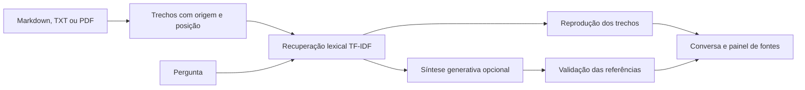

# Docora

🔗 **Demo online:** [docora.streamlit.app](https://docora.streamlit.app/) (modo extrativo, sem chave de API)

[](https://github.com/GustavoCurio/docora/actions/workflows/tests.yml)

**A resposta começa nos seus documentos — e mostra de onde veio.**

Localizar uma regra de atendimento entre políticas, produtos e procedimentos toma tempo e exige conferir a origem da informação. O Docora reúne consulta em português, recuperação lexical e respostas com trechos rastreáveis em uma conversa com painel de fontes. Na [avaliação reproduzível](reports/evaluation.json), atende a **28/28 critérios**, com **recuperação de fontes @3 de 100% nos 20 casos com seção esperada**. É um conjunto pequeno, elaborado a partir da própria base fictícia Lume Casa; esses números não demonstram generalização para documentos externos nem medem a qualidade de um modelo generativo.


[Estudo de caso](docs/ESTUDO_DE_CASO.md) · [Arquitetura](docs/ARQUITETURA.md) · [Avaliação](reports/evaluation.json)

## Destaques técnicos

| Recurso | Implementação |
|---|---|
| Recuperação local | TF-IDF de palavras e sequências de caracteres, com até três fontes por pergunta |
| Resposta extrativa | Reproduz trechos dos documentos, sem chave de API nem download de modelos |
| Fontes rastreáveis | Documento, seção, página ou linhas e identificador de trecho |
| Biblioteca própria | Ingestão de Markdown, TXT e PDF com texto selecionável, em memória e isolada da demonstração |
| Síntese com IA opcional | Aparece somente com chave no servidor; exige modelo configurado e autorização de envio |
| Histórico e exportação | Até seis consultas na sessão, inspeção de fontes por pergunta e download individual em JSON |
| Integração HTTP | FastAPI com contratos de entrada e documentação interativa |
| Validação automatizada | Testes da interface, ingestão, API e citações; integração contínua em Python 3.12 e 3.14 |

## Como rodar localmente

Use **Python 3.12**, a versão escolhida para o Streamlit Community Cloud. As dependências e os testes também foram verificados em Python 3.14.

Em Linux/macOS, na raiz do projeto:

```bash
python3.12 -m venv .venv
.venv/bin/python -m pip install -r requirements.txt
.venv/bin/python -m streamlit run app.py --server.port 8502
```

No Windows:

```powershell
py -3.12 -m venv .venv
.\.venv\Scripts\python.exe -m pip install -r requirements.txt
.\.venv\Scripts\python.exe -m streamlit run app.py --server.port 8502
```

Abra `http://127.0.0.1:8502`. A loja demonstrativa carrega automaticamente e funciona sem `OPENAI_API_KEY`, `OPENAI_MODEL` ou arquivo de segredos.

### Publicação no Streamlit Community Cloud

Ao criar o aplicativo, use o repositório `GustavoCurio/docora`, a branch `main`, o arquivo de entrada **`app.py`** e o subdomínio `docora`. Selecione **Python 3.12 nas configurações avançadas**, conforme a [documentação de publicação do Streamlit](https://docs.streamlit.io/deploy/streamlit-community-cloud/deploy-your-app/deploy).

O arquivo `requirements.txt` da raiz contém as dependências de execução. Não são necessários `packages.txt`, `runtime.txt` ou segredos para a demonstração extrativa: a versão de Python é selecionada no painel do Cloud. O índice demonstrativo usa cache em memória; uploads e histórico permanecem na memória da sessão. A interface não grava arquivos no repositório.

## Da pergunta à fonte

1. **Escolha a biblioteca:** a loja demonstrativa já está pronta. **Carregar exemplo** volta para ela e confirma o carregamento; cliques repetidos não duplicam documentos nem apagam uma conversa já aberta nessa base.
2. **Faça uma pergunta:** escolha uma pergunta rápida ou escreva no campo de mensagem.
3. **Leia a resposta:** o modo **Trechos dos documentos** reproduz evidências com referências como `[F1]`, `[F2]` e `[F3]`.
4. **Confira as fontes:** selecione uma pergunta do histórico, abra os trechos originais e verifique a página ou as linhas de origem.
5. **Guarde a consulta:** baixe a pergunta, a resposta e suas fontes em JSON.

Cada pergunta consulta a base de forma independente; o histórico não é enviado como contexto ao modelo. **Nova conversa** limpa as consultas da sessão. Mudar a base ou o formato da resposta inicia um histórico novo.

### Base demonstrativa Lume Casa

A **Lume Casa é uma loja fictícia**, com três documentos e vinte trechos sobre políticas e produtos criados para o projeto.

| Pergunta de exemplo | O que demonstra |
|---|---|
| Qual é o prazo de entrega para São Paulo? | Recuperação de uma política de entrega |
| Como posso devolver um produto? | Consulta a um procedimento |
| Existe desconto para Pix? | Localização de uma condição de pagamento |
| A Caneca Brisa pode ir ao micro-ondas? | Consulta a informações de produto |
| Qual é a previsão do tempo amanhã? | Pergunta sem informação correspondente na base |

Perguntas sobre pedidos individuais recebem orientação para atendimento autenticado. O projeto não consulta sistemas de pedidos, contas ou pagamentos.

### Usar seus documentos

Selecione **Meus documentos** e envie os arquivos. Essa biblioteca substitui a demonstração naquela sessão; as fontes exibidas pertencem à base selecionada.

| Limite | Valor |
|---|---:|
| Arquivos por base | Até 5 |
| Tamanho por arquivo | Até 2 MB |
| Páginas por PDF | Até 30 |
| Caracteres por arquivo | Até 150.000 |
| Caracteres por base | Até 300.000 |
| Trechos por base | Até 600 |

Markdown e TXT usam UTF-8. PDFs precisam ter texto selecionável; arquivos digitalizados precisam passar por OCR antes do envio.

## Avaliação e testes

O [relatório de referência](reports/evaluation.json) usa 28 perguntas da base demonstrativa:

| Grupo | Quantidade |
|---|---:|
| Consultas com documento e seção esperados | 20 |
| Perguntas fora da base | 5 |
| Casos de encaminhamento ou proteção de dados | 3 |

| Critério | Resultado no conjunto do projeto |
|---|---:|
| Perguntas com critérios atendidos | **28/28** |
| Seção esperada entre as três primeiras fontes | **20/20 · 100%** |

A avaliação é extrativa, sem chamada real a um modelo externo. Os casos foram elaborados com conhecimento da própria base; não constituem uma avaliação independente. Recuperar a seção esperada não comprova que uma síntese de IA seria correta.

Para reproduzir os testes e a avaliação, ou consultar pelo terminal:

```bash
.venv/bin/python -m pip install -r requirements-dev.txt
.venv/bin/python -m pytest -q
.venv/bin/python -m docora evaluate
.venv/bin/python -m docora ask "Como posso devolver um produto?"
```

No Windows, substitua `.venv/bin/python` por `.\.venv\Scripts\python.exe`. Por padrão, a avaliação grava `docora/evaluation.json` dentro do diretório temporário do sistema, sem sobrescrever o relatório versionado. Use `--output caminho/relatorio.json` para escolher outro destino gravável.

**52 testes** cobrem ingestão de texto e PDF, limites de entrada, isolamento entre bases, posições das fontes, citações, contratos da API, histórico e navegação. As regressões com `streamlit.testing.v1.AppTest` verificam inicialização sem variáveis ou segredos de API, pergunta demonstrativa com `[F1]`, recarga idempotente do exemplo e configurações opcionais do provedor. Todos os testes generativos usam clientes simulados, sem consumir créditos.

O [fluxo de integração contínua](.github/workflows/tests.yml) instala as dependências, executa `pytest` e `python -m docora evaluate` em **Python 3.12 e 3.14**.

## Síntese com IA opcional

Sem chave, a interface usa somente **Trechos dos documentos** e não exibe o seletor de formato. Para habilitar **Síntese com IA**, configure no servidor uma chave e um modelo da sua conta com suporte a saída estruturada. O modo extrativo continua sendo o padrão.

Em Linux/macOS:

```bash
export OPENAI_API_KEY="sua-chave"
export OPENAI_MODEL="modelo-compativel-com-saida-estruturada"
.venv/bin/python -m streamlit run app.py --server.port 8502
```

No Windows:

```powershell
$env:OPENAI_API_KEY = "sua-chave"
$env:OPENAI_MODEL = "modelo-compativel-com-saida-estruturada"
.\.venv\Scripts\python.exe -m streamlit run app.py --server.port 8502
```

A interface também aceita os segredos opcionais do Streamlit, no painel do Cloud ou em `.streamlit/secrets.toml` local:

```toml
OPENAI_API_KEY = "sua-chave"
OPENAI_MODEL = "modelo-compativel-com-saida-estruturada"
```

As variáveis de ambiente têm prioridade. Não há carregamento automático de `.env`; mantenha as credenciais fora do repositório. Com chave e sem modelo, a síntese fica indisponível com aviso explícito. A API HTTP e o terminal usam as variáveis de ambiente do servidor; os segredos do Streamlit são lidos pela interface.

Antes de qualquer consulta generativa, a interface exige autorização para enviar a pergunta e os trechos recuperados à OpenAI. A chamada pode consumir créditos da API. A integração usa a Responses API, saída JSON estruturada e `store=False`; os identificadores citados precisam corresponder às fontes recuperadas. Os trechos originais continuam disponíveis para conferência.

## API local

```bash
.venv/bin/python -m uvicorn docora.api:app --host 127.0.0.1 --port 8001
```

Documentação interativa: `http://127.0.0.1:8001/docs`.

| Rota | Finalidade |
|---|---|
| `GET /health` | Disponibilidade e quantidade de trechos |
| `GET /sources` | Documentos da base demonstrativa |
| `POST /ask` | Pergunta, resposta, fontes e duração |

Exemplo do corpo de uma consulta a `POST /ask`:

```json
{
  "question": "Como funciona o frete grátis?",
  "mode": "extractive"
}
```

O modo `generative` exige `approve_external_processing: true`. A API usa a base demonstrativa do servidor; o envio de documentos próprios é um recurso da interface.

## Arquitetura



| Caminho | Responsabilidade |
|---|---|
| `app.py` | Conversa, biblioteca, histórico e fontes; entrada do Streamlit |
| `docora/retrieval.py` | Ingestão, limites, trechos e busca lexical |
| `docora/assistant.py` | Respostas, encaminhamentos e validação de citações |
| `docora/api.py` | Integração HTTP |
| `docora/__main__.py` | Consulta e avaliação pelo terminal |
| `data/knowledge_base/` | Documentos demonstrativos da Lume Casa |
| `evals/questions.json` | Perguntas e critérios de verificação |

## Limitações

- A busca é lexical, sem embeddings semânticos, e pode falhar em paráfrases distantes do vocabulário da base.
- O conjunto de avaliação é pequeno e restrito à base fictícia; os resultados não se estendem automaticamente a outras empresas ou documentos.
- Validar identificadores de citação não comprova que cada afirmação gerada é sustentada pela fonte. A qualidade semântica da síntese não foi avaliada com chamadas reais.
- As regras para dados pessoais, consultas a pedidos e injeção de instruções são heurísticas limitadas.
- Não há OCR, persistência de uploads ou histórico entre sessões, nem acesso a pedidos individuais.
- A API não inclui autenticação ou limites de requisição. Exposição externa exige essas medidas e configuração dos segredos no servidor.

Consulte o [estudo de caso](docs/ESTUDO_DE_CASO.md) e a [arquitetura e validação](docs/ARQUITETURA.md). O desenvolvimento foi assistido por IA, com testes automatizados e fontes rastreáveis.
