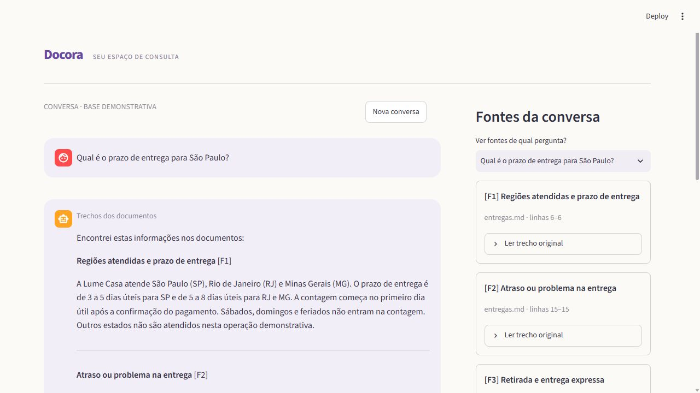
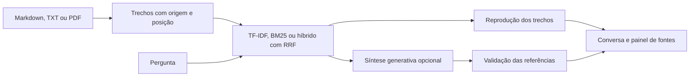

# Docora

🔗 **Demo online:** [docora-rag.streamlit.app](https://docora-rag.streamlit.app/) (modo extrativo, sem chave de API)

[](https://github.com/GustavoCurio/docora/actions/workflows/tests.yml)

**A resposta começa nos seus documentos — e mostra de onde veio.**

Localizar uma regra de atendimento entre políticas, produtos e procedimentos toma tempo e exige conferir a origem da informação. O Docora reúne consulta em português, recuperação lexical e semântica local e respostas com trechos rastreáveis em uma conversa com painel de fontes. O híbrido mantém **28/28 critérios no conjunto original** e alcança **30/38 no held-out**, contra 22/38 do TF-IDF. O Recall@3 no held-out passa de **52,17% para 69,57%**. São conjuntos pequenos da base fictícia Lume Casa; os números não demonstram generalização para documentos externos nem medem um modelo generativo. Confira os [resultados antes e depois](#avaliação-e-testes).



[Estudo de caso](docs/ESTUDO_DE_CASO.md) · [Arquitetura](docs/ARQUITETURA.md) · [Protocolo de avaliação](evals/README.md)

## Destaques técnicos

| Recurso | Implementação |
|---|---|
| Recuperação local | TF-IDF, BM25 ou BM25 + embeddings multilíngues ONNX com fusão RRF; até três fontes |
| Resposta extrativa | Seleciona até seis sentenças/120 palavras, com citação por sentença; funciona sem chave |
| Fontes rastreáveis | Documento, seção, página ou linhas e identificador de trecho |
| Biblioteca própria | Ingestão de Markdown, TXT e PDF com texto selecionável, em memória e isolada da demonstração |
| Síntese com IA opcional | Aparece somente com chave no servidor; exige modelo configurado e autorização de envio |
| Histórico e exportação | Até seis consultas na sessão, inspeção de fontes por pergunta e download individual em JSON |
| Integração HTTP | FastAPI com contratos de entrada e documentação interativa |
| Validação automatizada | Testes da interface, ingestão, API e citações; integração contínua em Python 3.12 e 3.14 |

## Como rodar localmente

Use **Python 3.12**, a versão escolhida para o Streamlit Community Cloud e para a validação local desta mudança. O CI mantém a matriz Python 3.12 e 3.14.

Em Linux/macOS, na raiz do projeto:

```bash
python3.12 -m venv .venv
.venv/bin/python -m pip install -r requirements.txt
.venv/bin/python -m streamlit run app.py --server.port 8502
```

No Windows:

```powershell
py -3.12 -m venv .venv
.\.venv\Scripts\python.exe -m pip install -r requirements.txt
.\.venv\Scripts\python.exe -m streamlit run app.py --server.port 8502
```

Abra `http://127.0.0.1:8502`. A loja demonstrativa carrega automaticamente e funciona sem `OPENAI_API_KEY`, `OPENAI_MODEL` ou arquivo de segredos.

### Publicação no Streamlit Community Cloud

Ao criar o aplicativo, use o repositório `GustavoCurio/docora`, a branch `main`, o arquivo de entrada **`app.py`** e o subdomínio `docora`. Selecione **Python 3.12 nas configurações avançadas**, conforme a [documentação de publicação do Streamlit](https://docs.streamlit.io/deploy/streamlit-community-cloud/deploy-your-app/deploy).

O arquivo `requirements.txt` da raiz contém as dependências de execução. Não são necessários `packages.txt`, `runtime.txt` ou segredos para a demonstração extrativa: a versão de Python é selecionada no painel do Cloud. O índice demonstrativo usa cache em memória; uploads e histórico permanecem na memória da sessão. A interface não grava arquivos no repositório.

### Recuperadores e modelo local

O seletor **Método de busca** mostra a escolha e **Busca ativa** informa o método
efetivamente disponível. O padrão é `hybrid` quando o encoder já está no cache;
caso contrário, há retorno automático ao TF-IDF. A demo inicia sem download
implícito de pesos. BM25 também funciona sem modelo.

```bash
# Opcional: baixa somente pesos e tokenizador públicos; inferência local.
.venv/bin/python -m docora prepare-model
.venv/bin/python -m docora ask "Em quanto tempo o pedido chega na capital paulista?" --retriever hybrid

# Escolha explícita para a interface e a API; o terminal aceita --retriever.
export DOCORA_RETRIEVER="bm25"
.venv/bin/python -m streamlit run app.py --server.port 8502
```

| Configuração de ambiente | Efeito |
|---|---|
| `DOCORA_RETRIEVER=hybrid\|tfidf\|bm25` | Método solicitado; padrão `hybrid`, com retorno ao TF-IDF |
| `DOCORA_MODEL_CACHE=/caminho/gravavel` | Cache de pesos; padrão `/tmp/docora-models` |
| `DOCORA_ALLOW_MODEL_DOWNLOAD=1` | Permite download no primeiro carregamento; padrão desativado |
| `DOCORA_DISABLE_EMBEDDINGS=1` | Força indisponibilidade do encoder, usado no CI e em ambientes restritos |

O encoder é [multilingual-e5-small](https://huggingface.co/intfloat/multilingual-e5-small),
na [conversão ONNX quantizada da Xenova](https://huggingface.co/Xenova/multilingual-e5-small/blob/761b726dd34fb83930e26aab4e9ac3899aa1fa78/onnx/model_quantized.onnx),
com revisão fixa, vetores de 384 dimensões e execução CPU, sem Torch. Pesos e
tokenizador ocupam **135,39 MB decimais** no cache medido. Os vetores dos vinte
trechos da demo são pré-calculados ao criar seu índice em `st.cache_resource`;
um único modelo é compartilhado entre sessões. Uploads calculam vetores por
lotes de quatro, com aviso na interface e índice em memória por sessão.

Na [medição local com cache vazio](reports/runtime_hybrid_cold.json), a primeira
resposta, incluindo importações e download, levou **8,06 s**; o pico do processo
incluindo Streamlit foi **710 MiB**. Recriar o índice com o modelo carregado levou
**177 ms**. Não é uma medição dentro do Community Cloud: rede, CPU e sessões
concorrentes podem mudar esses valores. O limite documentado do [Community Cloud](https://docs.streamlit.io/deploy/streamlit-community-cloud/manage-your-app) é de **~2,7 GB**. Para decidir sobre modelos adicionais, usamos a margem conservadora de **~2 GB para o processo completo**. Para
inicialização previsível, o padrão usa somente cache local e mantém o TF-IDF
disponível. Em um novo contêiner Cloud sem pesos, é preciso habilitar o download
explicitamente para usar o híbrido. Falhas de importação, cache, carregamento ou
inferência retornam ao TF-IDF; encerramento do processo pelo sistema por falta
de memória não pode ser capturado pelo Python.

O [smoke com cache ausente](reports/runtime_fallback_no_cache.json) confirmou a
resposta extrativa pelo TF-IDF, sem importar ONNX nem criar cache, com pico de
**207 MiB** incluindo a interface. As medições com e sem encoder são locais.

## Da pergunta à fonte

1. **Escolha a biblioteca:** a loja demonstrativa já está pronta. **Carregar exemplo** volta para ela e confirma o carregamento; cliques repetidos não duplicam documentos nem apagam uma conversa já aberta nessa base.
2. **Faça uma pergunta:** escolha uma pergunta rápida ou escreva no campo de mensagem.
3. **Leia a resposta:** o modo **Trechos dos documentos** reproduz evidências com referências como `[F1]`, `[F2]` e `[F3]`.
4. **Confira as fontes:** selecione uma pergunta do histórico, abra os trechos originais e verifique a página ou as linhas de origem.
5. **Guarde a consulta:** baixe a pergunta, a resposta e suas fontes em JSON.

Cada pergunta consulta a base de forma independente; o histórico não é enviado como contexto ao modelo. **Nova conversa** limpa as consultas da sessão. Mudar a base, o método de busca ou o formato da resposta inicia um histórico novo.

### Base demonstrativa Lume Casa

A **Lume Casa é uma loja fictícia**, com três documentos e vinte trechos sobre políticas e produtos criados para o projeto.

| Pergunta de exemplo | O que demonstra |
|---|---|
| Qual é o prazo de entrega para São Paulo? | Recuperação de uma política de entrega |
| Como posso devolver um produto? | Consulta a um procedimento |
| Existe desconto para Pix? | Localização de uma condição de pagamento |
| A Caneca Brisa pode ir ao micro-ondas? | Consulta a informações de produto |
| Qual é a previsão do tempo amanhã? | Pergunta sem informação correspondente na base |

Perguntas sobre pedidos individuais recebem orientação para atendimento autenticado. O projeto não consulta sistemas de pedidos, contas ou pagamentos.

### Usar seus documentos

Selecione **Meus documentos** e envie os arquivos. Essa biblioteca substitui a demonstração naquela sessão; as fontes exibidas pertencem à base selecionada.

| Limite | Valor |
|---|---:|
| Arquivos por base | Até 5 |
| Tamanho por arquivo | Até 2 MB |
| Páginas por PDF | Até 30 |
| Caracteres por arquivo | Até 150.000 |
| Caracteres por base | Até 300.000 |
| Trechos por base | Até 600 |

Markdown e TXT usam UTF-8. PDFs precisam ter texto selecionável; arquivos digitalizados precisam passar por OCR antes do envio.

## Avaliação e testes

O [conjunto original](evals/questions.json) contém 20 perguntas com fonte, cinco
negativos e três encaminhamentos. O [held-out separado](evals/heldout_questions.json)
contém 23 perguntas com fonte, 12 negativos e três encaminhamentos. Foi congelado
e medido em commit anterior à implementação híbrida. **O held-out não foi usado
para ajustar aliases, pesos ou cortes; os aliases TF-IDF permanecem intactos.**
O corte semântico foi escolhido com o original e oito negativos de
[desenvolvimento](evals/development_questions.json), com
[grade de calibração registrada](reports/calibration_development.json).

Resultados locais reais em Python 3.12, modo extrativo. R@k, precisão de
`not_found`, falso positivo OOD e fidelidade são percentuais; MRR@5 vai de 0 a 1.

| Conjunto | Recuperador | R@1 | R@3 | R@5 | MRR@5 | Precisão not_found | Falso positivo OOD | Fidelidade lexical |
|---|---|---:|---:|---:|---:|---:|---:|---:|
| Original | [TF-IDF antes](reports/baseline_tfidf_original.json) | 100 | 100 | 100 | 1,0000 | 100 | 0 | 100 |
| Original | [BM25](reports/bm25_original.json) | 100 | 100 | 100 | 1,0000 | 100 | 0 | 100 |
| Original | [Híbrido real](reports/hybrid_original.json) | 100 | 100 | 100 | 1,0000 | 100 | 0 | 100 |
| Held-out | [TF-IDF antes](reports/baseline_tfidf_heldout.json) | 47,83 | 52,17 | 52,17 | 0,5000 | 43,75 | 41,67 | 100 |
| Held-out | [BM25](reports/bm25_heldout.json) | 47,83 | 52,17 | 52,17 | 0,5000 | 43,75 | 41,67 | 100 |
| Held-out | [Híbrido real](reports/hybrid_heldout.json) | 65,22 | 69,57 | 69,57 | 0,6739 | 64,71 | 8,33 | 100 |

Todos atendem 28/28 critérios no original. No held-out, TF-IDF e BM25 atendem
22/38; o híbrido atende 30/38. Os falsos positivos OOD caem de **5/12 para 1/12**;
“parcelamento do imposto de renda” ainda recupera uma seção de pagamentos da
loja. BM25 conserva os filtros lexicais do TF-IDF, por isso não amplia sua
cobertura neste conjunto. A nova ordenação sozinha não resolve as paráfrases.

No smoke real “Em quanto tempo o pedido chega na capital paulista?”, TF-IDF
traz **Cancelamento do pedido**; o híbrido traz **Regiões atendidas e prazo de
entrega** em primeiro lugar, com o trecho de 3 a 5 dias úteis para SP.
“Transferência instantânea” ainda recebe `not_found`; a política de
reembolso/devolução é localizada, mas outras formulações coloquiais continuam
falhando. Todas as falhas constam nos JSON, sem remoção de casos após medir.

Recall@k conta perguntas com qualquer fonte aceitável no ranking **após os
filtros da aplicação**. MRR é limitado a cinco posições. Casos multisseção aceitam
qualquer par declarado, sem medir cobertura integral. Precisão de `not_found`
inclui falsos negativos de consultas respondíveis no denominador. A fidelidade
compara as sentenças reais da resposta ao trecho citado: pelo menos 80% dos
termos normalizados devem estar presentes. **100% de fidelidade lexical não
significa que a fonte responde à pergunta:** copiar uma seção errada também pode
atingir 100%. Consulte o [schema e as regras completas](evals/README.md).

```bash
.venv/bin/python -m pip install -r requirements-dev.txt
.venv/bin/python -m pytest -q
.venv/bin/python -m docora evaluate --suite original --retriever tfidf
.venv/bin/python -m docora evaluate --suite heldout --retriever tfidf --allow-failures --output /tmp/tfidf-heldout.json
.venv/bin/python -m docora evaluate --suite all --retriever bm25 --allow-failures

# Integração optativa com encoder real: preparar o cache apenas uma vez.
.venv/bin/python -m docora prepare-model
.venv/bin/python -m docora evaluate --suite original --retriever hybrid
.venv/bin/python -m docora evaluate --suite heldout --retriever hybrid --allow-failures --output /tmp/hybrid-heldout.json
.venv/bin/python -m pytest -q -m slow tests/test_real_embeddings.py
.venv/bin/python scripts/benchmark_retrieval.py --output /tmp/recursos-hibrido.json
```

No Windows, substitua `.venv/bin/python` por `.\.venv\Scripts\python.exe`;
o medidor de memória usa `resource` do Linux. O padrão da avaliação grava
`docora/evaluation.json` no diretório temporário, preservando os relatórios
versionados. `--suite all` mantém as duas populações separadas no mesmo JSON.
Sem `--allow-failures`, qualquer critério não atendido encerra com código 1.
O relatório mostra recuperador solicitado e ativo: uma execução com fallback
não é apresentada como resultado híbrido.

A suíte rápida usa encoders simulados e verifica BM25, RRF, cortes semânticos,
falhas de carregamento/inferência, isolamento de bases, PDF, citações, API e
Streamlit sem chave. `pytest -q` exclui o marcador `slow` por padrão. O teste
optativo exige modelo real no cache e falha se não o encontrar. Todos os testes
generativos usam clientes simulados, sem consumir créditos.

O [CI](.github/workflows/tests.yml) mantém a matriz **Python 3.12/3.14**, cache de
pip, embeddings desativados e download bloqueado. Executa o original TF-IDF e
mede também o fallback explícito nas duas suítes. Não exige aprovação de todos
os casos do held-out nem baixa pesos em cada job.

## Respostas por sentenças e reranking — itens 5 e 6

O modo `extractive` agora seleciona sentenças dos três melhores trechos. Usa
overlap lexical, seção e prioridade do ranking; quando o híbrido está ativo,
reutiliza o E5 para comparar sentenças com a pergunta. Não carrega outro encoder.
Remove repetições, preservando diferenças numéricas e negações; ordena por fonte
e posição original. O limite é de **seis sentenças e 120 palavras**, sem cortar
uma sentença no meio. Cada sentença termina com sua citação `[Fn]`. Só fontes
citadas permanecem na resposta. Guardrails continuam antes da busca; ausência
de evidência mantém `not_found`. Se nenhuma sentença couber, também se abstém.

Comparação real do extrativo anterior com o novo, mesmas perguntas e corpus:

| Recuperador / conjunto | Palavras médias antes → depois | Citação inline por sentença (%) | Fidelidade lexical (%) | Critérios antes → depois | Dentro de 6 sentenças/120 palavras antes → depois |
|---|---:|---:|---:|---:|---:|
| TF-IDF / original | 63,30 → 37,60 | 0 → 100 | 100 → 100 | 28/28 → 28/28 | 24/28 → 28/28 |
| TF-IDF / held-out | 54,16 → 30,05 | 0 → 100 | 100 → 100 | 22/38 → 22/38 | 35/38 → 38/38 |
| Híbrido / original | 48,65 → 30,50 | 0 → 100 | 100 → 100 | 28/28 → 28/28 | 27/28 → 28/28 |
| Híbrido / held-out | 67,56 → 34,00 | 0 → 100 | 100 → 100 | 30/38 → 30/38 | 32/38 → 38/38 |

O extrativo anterior citava o cabeçalho do bloco, por isso sua citação inline
por sentença era zero, apesar do suporte lexical de 100%. Depois, 100% das
sentenças são fragmentos literais da fonte citada; nenhuma resposta tem duplicata
exata. A seção esperada é citada no corpo em 100% do original, 52,17% do held-out
TF-IDF e 69,57% do held-out híbrido. Isso mede proveniência e cobertura de uma
fonte aceitável, sem garantir resposta completa. Veja os relatórios
[antes TF-IDF](reports/items56_before_tfidf.json),
[depois TF-IDF](reports/items5_after_tfidf.json),
[antes híbrido](reports/items56_before_hybrid.json) e
[depois híbrido](reports/items5_after_hybrid.json), com o texto de cada resposta.

Os rerankers reordenam **até dez candidatos já aceitos pelos filtros**. As regras
combinam prioridade, match da seção/título e overlap do corpo, sem modelo extra.
O CE escolhido é [mMARCO mMiniLMv2 L12 H384 multilíngue](https://huggingface.co/cross-encoder/mmarco-mMiniLMv2-L12-H384-v1),
revisão `1427fd652930e4ba29e8149678df786c240d8825`, arquivo
`onnx/model_quint8_avx2.onnx`: **118.620.016 bytes (113,12 MiB)** de pesos,
mais 17.082.660 bytes de tokenizador. Executa localmente, sem Torch, com duas
threads, lotes de dois pares e até 256 tokens por par. Não usa logits para
reclassificar OOD nem ressuscita evidências rejeitadas.

| Held-out / recuperação + reranker | R@1 (%) | R@3 (%) | MRR@5 | Falso positivo OOD (%) | Critérios |
|---|---:|---:|---:|---:|---:|
| [TF-IDF + none](reports/items5_after_tfidf.json) | 47,83 | 52,17 | 0,5000 | 41,67 | 22/38 |
| [TF-IDF + rules](reports/items6_rules_tfidf.json) | 47,83 | 52,17 | 0,5000 | 41,67 | 22/38 |
| [TF-IDF + crossencoder](reports/items6_crossencoder_tfidf.json) | 52,17 | 52,17 | 0,5217 | 41,67 | 22/38 |
| [Híbrido + none](reports/items5_after_hybrid.json) | 65,22 | 69,57 | 0,6739 | 8,33 | 30/38 |
| [Híbrido + rules](reports/items6_rules_hybrid.json) | 65,22 | 69,57 | 0,6739 | 8,33 | 30/38 |
| [Híbrido + crossencoder](reports/items6_crossencoder_hybrid.json) | 65,22 | 69,57 | 0,6739 | 8,33 | 30/38 |

No original, as seis opções mantêm **28/28**, R@1/R@3 de 100%, MRR@5 1,0000,
OOD 0% e fidelidade lexical 100%. No held-out, todas mantêm fidelidade lexical
100%. A avaliação usa um único ranking por pergunta tanto na resposta quanto
nas métricas. Aliases, corpus, cortes e casos permaneceram intactos; não houve
retuning no held-out. Empates agregados não implicam rankings idênticos por caso.

Recursos reais em Python 3.12.16, Linux/CPU, com E5 e Streamlit AppTest, processos
novos por opção. A RAM extra abaixo é a diferença de picos entre processos;
inclui ruído de alocação. As regras não adicionam pesos de modelo.

| Reranker | Pico total (MiB) | Pico extra vs none (MiB) | Primeira resposta, pesos em disco (s) |
|---|---:|---:|---:|
| [none](reports/items6_runtime_none.json) | 708,17 | 0 | 2,35 |
| [rules](reports/items6_runtime_rules.json) | 713,62 | +5,45 | 2,07 |
| [crossencoder](reports/items6_runtime_crossencoder.json) | 1.118,45 | +410,28 | 3,15 |

| Reranker | Busca média / p95 (ms) | Resposta completa média / p95 (ms) | Reranking não vazio médio (ms) | Dez pares, reranking médio (ms) |
|---|---:|---:|---:|---:|
| none | 2,84 / 3,37 | 12,89 / 34,12 | 0 | 0 |
| rules | 3,00 / 3,63 | 13,37 / 35,11 | 0,08 | 0,30 |
| crossencoder | 20,29 / 56,84 | 31,11 / 94,90 | 33,28 | 203,18 |

São três rodadas de 35 perguntas held-out sem guardrail, incluindo OOD que não
executa reranking quando não há candidatos. A resposta completa inclui seleção
de sentenças. O [cold start sem CE no cache](reports/items6_runtime_crossencoder_cold.json),
com E5 já em disco, levou **9,86 s**, incluindo download do CE; pico **1.129,36 MiB**.
Não é medição dentro do Cloud nem teste de sessões simultâneas.

**Por que escolhi:** mantenho **`DOCORA_RERANKER=none`** no padrão e na demo.
O CE coube na margem local de ~2 GB (pico de ~1,10 GiB, incluindo E5 e UI), mas
não melhorou o held-out híbrido: R@1 65,22%, R@3 69,57%, MRR 0,6739 e um falso
positivo em 12 OOD permaneceram iguais. O pequeno ganho no TF-IDF não supera o
híbrido. As regras também empataram e acrescentam trabalho. Assim, as duas
opções ficam disponíveis para experimentos locais; o CE permanece **off por
padrão no Cloud**. O teto oficial do Community Cloud é **~2,7 GB**; a margem de
~2 GB é uma escolha conservadora para a decisão, sem garantia de capacidade
sob concorrência. Um novo domínio exige nova avaliação antes de mudar o padrão.

Configuração e reprodução, sem chamadas à OpenAI:

```bash
export DOCORA_MODEL_CACHE=/tmp/docora-models
export DOCORA_RERANKER=none  # none | rules | crossencoder
# Sem a autorização abaixo, o código usa apenas arquivos já no cache.
export DOCORA_ALLOW_MODEL_DOWNLOAD=0
.venv/bin/python -m docora prepare-model
.venv/bin/python -m docora prepare-reranker
.venv/bin/python -m docora ask "Em quanto tempo o pedido chega na capital paulista?" --retriever hybrid --reranker crossencoder
.venv/bin/python -m docora evaluate --suite all --retriever hybrid --reranker crossencoder --allow-failures --output /tmp/avaliacao-ce.json
.venv/bin/python scripts/benchmark_reranking.py --reranker crossencoder --output /tmp/recursos-ce.json
```

`prepare-model` e `prepare-reranker` autorizam explicitamente o download público
para preparar seus respectivos caches. Fora desses comandos, somente
`DOCORA_ALLOW_MODEL_DOWNLOAD=1` autoriza baixar pesos/tokenizador. O CE só é
carregado quando solicitado: o download do E5 já autorizado na
[demo](https://docora-rag.streamlit.app/) não liga o CE. Ausência ou falha do CE
retorna a `rules`, com motivo visível na CLI/UI/API; `DOCORA_DISABLE_RERANKER=1`
também força esse fallback. Falhas de carga são memorizadas até reiniciar o
processo. O encerramento por OOM do sistema operacional não é capturável.

A suíte rápida passou com **103 testes em Python 3.12 e 3.14**, sem modelos nem
downloads; os dois testes `slow` passaram com E5 e CE reais em cache, no Python
3.12. A matriz de CI mantém 3.12/3.14, gates fechados e mocks para o CE.
[Avaliação original em 3.14](reports/items56_original_python314.json) e
[fallback real sem cache](reports/items56_fallback_all.json) preservam 28/28.

## Síntese com IA opcional

Sem chave, a interface usa somente **Trechos dos documentos** e não exibe o seletor de formato. Para habilitar **Síntese com IA**, configure no servidor uma chave e um modelo da sua conta com suporte a saída estruturada. O modo extrativo continua sendo o padrão.

Em Linux/macOS:

```bash
export OPENAI_API_KEY="sua-chave"
export OPENAI_MODEL="modelo-compativel-com-saida-estruturada"
.venv/bin/python -m streamlit run app.py --server.port 8502
```

No Windows:

```powershell
$env:OPENAI_API_KEY = "sua-chave"
$env:OPENAI_MODEL = "modelo-compativel-com-saida-estruturada"
.\.venv\Scripts\python.exe -m streamlit run app.py --server.port 8502
```

A interface também aceita os segredos opcionais do Streamlit, no painel do Cloud ou em `.streamlit/secrets.toml` local:

```toml
OPENAI_API_KEY = "sua-chave"
OPENAI_MODEL = "modelo-compativel-com-saida-estruturada"
```

As variáveis de ambiente têm prioridade. Não há carregamento automático de `.env`; mantenha as credenciais fora do repositório. Com chave e sem modelo, a síntese fica indisponível com aviso explícito. A API HTTP e o terminal usam as variáveis de ambiente do servidor; os segredos do Streamlit são lidos pela interface.

Antes de qualquer consulta generativa, a interface exige autorização para enviar a pergunta e os trechos recuperados à OpenAI. A chamada pode consumir créditos da API. A integração usa a Responses API, saída JSON estruturada e `store=False`; os identificadores citados precisam corresponder às fontes recuperadas. Os trechos originais continuam disponíveis para conferência.

## API local

```bash
.venv/bin/python -m uvicorn docora.api:app --host 127.0.0.1 --port 8001
```

Documentação interativa: `http://127.0.0.1:8001/docs`.

| Rota | Finalidade |
|---|---|
| `GET /health` | Disponibilidade e quantidade de trechos |
| `GET /sources` | Documentos da base demonstrativa |
| `POST /ask` | Pergunta, resposta, fontes e duração |

Exemplo do corpo de uma consulta a `POST /ask`:

```json
{
  "question": "Como funciona o frete grátis?",
  "mode": "extractive"
}
```

O modo `generative` exige `approve_external_processing: true`. A API usa a base demonstrativa do servidor; o envio de documentos próprios é um recurso da interface.

## Arquitetura



| Caminho | Responsabilidade |
|---|---|
| `app.py` | Conversa, biblioteca, histórico e fontes; entrada do Streamlit |
| `docora/retrieval.py` | Ingestão, limites, seleção de recuperação e fallback |
| `docora/ranking.py` | BM25 e fusão RRF |
| `docora/embeddings.py` | Encoder ONNX quantizado local e cache de carregamento |
| `docora/evaluation.py` | Recuperação, abstenção e fidelidade lexical |
| `docora/assistant.py` | Respostas, encaminhamentos e validação de citações |
| `docora/api.py` | Integração HTTP |
| `docora/__main__.py` | Consulta e avaliação pelo terminal |
| `data/knowledge_base/` | Documentos demonstrativos da Lume Casa |
| `evals/` | Original, held-out, negativos de desenvolvimento e schema |
| `reports/` | Baselines, comparação por método, calibração e medições de recursos |

## Limitações

- O híbrido melhora algumas paráfrases, mas ainda rejeita perguntas respondíveis e aceita alguns assuntos fora da base. Os cortes são heurísticos e não garantem segurança semântica.
- O encoder local tem custo de memória e primeiro carregamento. Sem cache ou em caso de falha, o método ativo passa a TF-IDF; o painel informa esse estado.
- O conjunto de avaliação é pequeno e restrito à base fictícia; os resultados não se estendem automaticamente a outras empresas ou documentos.
- Validar identificadores de citação não comprova que cada afirmação gerada é sustentada pela fonte. A qualidade semântica da síntese não foi avaliada com chamadas reais.
- As regras para dados pessoais, consultas a pedidos e injeção de instruções são heurísticas limitadas.
- Não há OCR, persistência de uploads ou histórico entre sessões, nem acesso a pedidos individuais.
- A API não inclui autenticação ou limites de requisição. Exposição externa exige essas medidas e configuração dos segredos no servidor.

Consulte o [estudo de caso](docs/ESTUDO_DE_CASO.md) e a [arquitetura e validação](docs/ARQUITETURA.md). O desenvolvimento foi assistido por IA, com testes automatizados e fontes rastreáveis.
