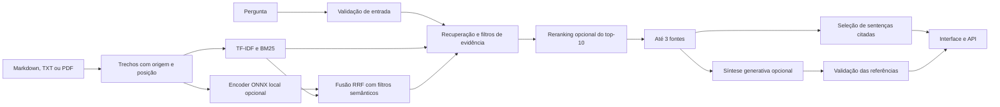

# Arquitetura e validação



## Ingestão e recuperação

Markdown é segmentado por títulos; texto e PDF são divididos em trechos limitados por tamanho. PDFs preservam a página. Arquivos textuais preservam a faixa de linhas. O identificador é derivado de arquivo, posição, seção e conteúdo.

Há três recuperadores, selecionados por `DOCORA_RETRIEVER` ou `--retriever` na CLI:

- **TF-IDF:** palavras com peso 0,8 e caracteres com peso 0,2. Mantém os aliases
  anteriores, corte 0,14 e cobertura mínima de 20% dos termos expandidos.
- **BM25:** Okapi com IDF positivo, k1=1,5 e b=0,75. Usa a mesma normalização de
  acentos/caixa e stopwords, preservando frequências. Reordena os candidatos
  aprovados pelos filtros lexicais do TF-IDF; não amplia sua cobertura.
- **Híbrido:** embeddings normalizados do multilingual-e5-small quantizado
  ONNX, pooling médio com máscara e prefixos `query:`/`passage:`. Usa até 256
  tokens por trecho. Exige cosseno >=0,85 e distância <=0,03 do melhor candidato,
  depois funde as listas BM25 e semântica por RRF: soma de `1/(60 + posição)`,
  com posições a partir de um e listas limitadas a dez. Não exige coincidência
  lexical para recuperar paráfrases. O escore RRF não decide abstenção.

Os escores têm escalas diferentes e não são probabilidades de resposta correta.
O corte semântico foi calibrado no original e em negativos de desenvolvimento,
com parâmetros congelados antes de avaliar o híbrido no held-out. A calibração
reproduz consultas individuais: quantização dinâmica pode variar com o padding
do lote. O corpus e os aliases permanecem iguais aos do baseline.

O padrão solicita híbrido, usando somente pesos já disponíveis no cache.
`prepare-model` baixa os dois arquivos públicos necessários em uma revisão fixa;
`DOCORA_ALLOW_MODEL_DOWNLOAD=1` permite fazê-lo no primeiro carregamento.
Sem encoder, ou em falha de importação/carregamento/inferência, o índice retorna
ao TF-IDF e informa método ativo e motivo. A interface mostra o método ativo.

`st.cache_resource` compartilha modelo e índice da demo. Seus vinte vetores são
pré-calculados ao criar o índice. Uploads reutilizam o encoder e calculam vetores
por lotes de quatro, com aviso de demora, mantendo o índice na sessão. Um lock
protege tokenização e inferência do modelo compartilhado. ONNX usa CPU, duas
threads e arena de memória desativada; não há dependência de Torch.

## Resposta e citações

No modo extrativo, a aplicação segmenta os três trechos recuperados em sentenças (pontuação e linhas; preserva decimais e abreviações usuais). A seleção usa overlap com a pergunta expandida, seção e prioridade do ranking. No híbrido, soma o cosseno das sentenças com a pergunta, reutilizando o E5 carregado; uma falha nessa etapa mantém a seleção lexical, sem carregar outro modelo. Reserva uma sentença por fonte quando couber, preenche com sentenças com overlap e remove duplicatas por Jaccard ≥0,85 ou semelhança textual ≥0,92. Diferenças em números, negações e condições usuais impedem deduplicação para preservar possíveis conflitos. A resposta contém até seis sentenças e 120 palavras, preserva a posição dentro de cada trecho e inclui `[Fn]` em cada sentença. Sentenças acima do orçamento são omitidas inteiras; se nenhuma couber, retorna `not_found`. Só fontes efetivamente citadas permanecem na resposta. O status evidence_found significa que há evidência textual relacionada; não garante que todos os detalhes da pergunta estejam respondidos.

O reranker atua depois dos filtros de evidência e antes do corte de três fontes da resposta. `DOCORA_RERANKER=none|rules|crossencoder` e `--reranker` selecionam o modo; `none` é o padrão em todos os ambientes. As regras combinam prioridade do ranking, overlap no título/seção/corpo e frase de seção, sem pesos de modelo adicionais. O cross-encoder pontua até dez candidatos aceitos com mMARCO mMiniLMv2 L12 H384, ONNX INT8, revisão fixa, CPU, duas threads, arena desativada, pares de até 256 tokens e lotes de dois. Ambos preservam os escores originais do recuperador e apenas mudam a ordem. Nenhum deles recupera um candidato rejeitado nem substitui os cortes OOD por logits do CE.

O CE usa o mesmo gate dos embeddings: `DOCORA_ALLOW_MODEL_DOWNLOAD=1` permite baixar os dois arquivos públicos somente quando o CE foi solicitado; sem essa flag, só consulta o cache `DOCORA_MODEL_CACHE`. O comando `prepare-reranker` autoriza explicitamente esse preparo. Ausência, erro de carga ou inferência voltam a `rules`; `DOCORA_DISABLE_RERANKER=1` também desativa o CE. A carga é compartilhada por processo e falhas são memorizadas até reiniciar. UI, CLI e API informam o modo ativo e eventual fallback. O download do E5 autorizado na demo não ativa o CE automaticamente. A decisão medida está no README.

No modo generativo, a pergunta e até três trechos são enviados à Responses API com instruções para usar exclusivamente as evidências. A saída estruturada contém answer, answerable e citations. Identificadores ausentes, citações inexistentes e divergências entre marcadores no texto e lista de fontes invalidam a resposta.

A verificação de identificadores confirma a origem citada, mas não verifica automaticamente se toda afirmação é sustentada pelo conteúdo. A avaliação semântica das respostas do modelo é uma dimensão distinta dos testes de contrato.

## Dados e processamento

- A base de demonstração contém documentos fictícios e públicos no repositório.
- Documentos enviados pelo painel são mantidos na memória da sessão e substituem a base demonstrativa nas consultas.
- A aplicação não grava uploads nem histórico de perguntas em arquivos.
- O modo local não envia documentos a um provedor externo.
- O download opcional acessa apenas pesos/tokenizador públicos. Textos e perguntas
  são codificados localmente; o cache de modelo fica fora do repositório.
- A síntese externa exige autorização no formulário ou na chamada da API e usa store=False; as políticas de retenção do provedor continuam aplicáveis.
- A detecção de alguns formatos de CPF/cartão e de consultas a pedidos é uma camada de entrada, não um detector universal de dados pessoais.
- A instrução de tratar pergunta e documentos como dados não confiáveis reduz risco de injeção de prompt, mas não garante eliminação de ataques.

## Limites operacionais

Até cinco documentos por sessão, 2 MB por arquivo, 30 páginas por PDF e no máximo 300.000 caracteres ou 600 trechos por base. PDFs precisam conter texto selecionável; OCR não faz parte desta implementação.

No Linux local com Python 3.12, o processo com encoder e AppTest atingiu pico de
710 MiB; cache vazio levou 8,06 s até a primeira resposta, incluindo download.
Com pesos em disco, um processo novo respondeu em 2,27 s; com modelo em memória,
recriar os vetores da demo levou cerca de 173–177 ms. Relatórios em
`reports/runtime_hybrid_*.json`. A medição não é um teste de carga no Community
Cloud: múltiplas sessões e bases maiores consomem mais memória. O [limite oficial](https://docs.streamlit.io/deploy/streamlit-community-cloud/manage-your-app) é de ~2,7 GB; a decisão sobre o cross-encoder exige margem abaixo de ~2 GB para o app completo. A demo padrão
mantém o CE desligado; na demo publicada o download do E5 está autorizado explicitamente. Sem cache e sem autorização, o código retorna ao TF-IDF. Encerramento por OOM do sistema operacional
não é recuperável por `try/except`.

A API usa a base demonstrativa do servidor e não inclui autenticação de usuários. A publicação externa deve adicionar autenticação, limites de tráfego e gerenciamento de segredos. Os comandos do README mantêm o serviço restrito ao computador local.

## Avaliação reproduzível

```bash
python -m pytest -q
python -m docora evaluate --suite all --retriever tfidf --allow-failures
python -m docora prepare-model
python -m docora evaluate --suite all --retriever hybrid --allow-failures
python -m pytest -q -m "slow and model" tests/models/test_real_embeddings.py
```

O original tem 28 casos e o held-out separado tem 38. Os relatórios preservam
baseline anterior à mudança, recuperador solicitado/ativo, hashes do corpus e
dos casos e resultados por pergunta. Medem Recall@1/3/5 após filtros, MRR@5,
precisão de abstenção, falso positivo OOD e suporte lexical das sentenças ao
trecho citado. Não medem inferência semântica nem correção de um LLM.
O [protocolo e schema](../evals/README.md) detalham denominadores e tratamento de
alternativas multisseção. O [README](../README.md#avaliação-e-testes) compara os
três métodos com números reais. O CI usa encoders simulados, impede download e
exclui `slow`; a integração optativa exige encoder real disponível no cache.

## Contratos e qualidade de código

`docora/contracts.py` descreve os campos dos trechos e das fontes com
`TypedDict`, além dos protocolos de busca, encoder e cross-encoder injetáveis.
A avaliação reutiliza seu ranking na resposta por meio do contrato de busca.
Esses contratos permitem verificar o pacote com mypy sem carregar os runtimes
ONNX nem exigir modelos nos testes. As conversões de tipo das matrizes esparsas
e dos modelos opcionais descrevem os estados já estabelecidos pelo recuperador
ativo; não acrescentam validações ou mudam os filtros de evidência.

O `pyproject.toml` reúne pytest com marcadores estritos, Ruff em 120 colunas,
mypy sobre `docora/` e cobertura de linhas e ramos. Os testes ficam separados
por domínio, com fixtures e isolamento de credenciais/cache em
`tests/conftest.py`. A suíte rápida mantém 103 testes ativos e dois optativos
com os marcadores `slow` e `model`; a coleta completa contém 105 testes.
A cobertura local medida em Python 3.12.16 é **90,41%**, com mínimo de **90,0%**.
O CI verifica lint, formatação e tipos, executa a matriz 3.12/3.14 e publica
`coverage.xml`, mantendo as avaliações TF-IDF e de fallback sem baixar modelos.
Os comandos e as exceções de análise estão no
[README — Qualidade de código](../README.md#qualidade-de-código).

Referência para a integração: [documentação oficial de saídas estruturadas](https://developers.openai.com/api/docs/guides/structured-outputs).
